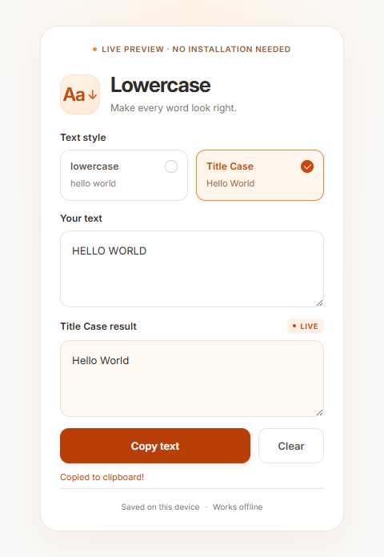

# Lowercase

A small Chrome extension for instant **lowercase** and **Title Case** conversion. Choose a style with a radio card, paste your text, and copy the result with one click.



## Features

- **lowercase:** `HELLO WORLD` → `hello world`
- **Title Case:** `HELLO WORLD` → `Hello World`
- White-and-orange interface with a bundled Inter font
- Selectable cards with checkmarks and keyboard navigation
- Instant conversion, one-click copying, and a Clear button
- Remembers your latest text and selected style on this device
- Preserves whitespace, line breaks, punctuation, and multilingual input
- Works offline, with no runtime dependencies or network requests

## Install

1. Download this repository as a ZIP using **Code → Download ZIP**, or clone it.
2. Extract the archive if needed.
3. Open `chrome://extensions` in Google Chrome.
4. Enable **Developer mode**, then click **Load unpacked**.
5. Select the **`lowercase-extension`** folder inside the downloaded project. It contains `manifest.json`.
6. Pin **Lowercase** from Chrome's extensions menu, then click its icon.

Choose **lowercase** or **Title Case**, paste into **Your text**, and click **Copy text**. **Clear** deletes your saved text while keeping the selected style.

For a trial without installing the extension, open **`lowercase-preview.html`** in Chrome. It is a standalone file; its saved text is separate from the extension's saved text.

## Develop

The extension uses plain HTML, CSS, and JavaScript with Manifest V3. No build step is needed to load it. To run the checks or rebuild the standalone preview, install Node.js and run:

```sh
node --test lowercase-extension/tests/popup.test.mjs
node tools/build-preview.mjs
```

After changing the extension, click **Reload** on its card in `chrome://extensions`, then reopen the popup. Regenerate the preview after editing the popup files so both interfaces stay in sync.

To create an installation archive in PowerShell:

```powershell
Compress-Archive -Path lowercase-extension -DestinationPath lowercase-extension.zip -Force
```

## Privacy and fonts

Only the `storage` permission is requested. Text and preferences stay in the extension's local storage. The extension does not read web pages or your clipboard and sends no text to a server. It writes to the clipboard when you click **Copy text**.

Inter is bundled under the SIL Open Font License; see [the font license](lowercase-extension/fonts/OFL.txt). The standalone preview embeds the font and its license.

See [the extension guide](lowercase-extension/README.md) for detailed behavior, troubleshooting, and references.
